# Benchmarking computational doublet-detection methods for scRNA-seq data

**Cahid Enes Keleş** · Istanbul Technical University · *Final report, November 2026*

> All numbers come from the committed results and can be regenerated with `analysis/run_all.sh`.
> Every table behind the text is in [`data.md`](data.md); section numbers there are given as
> "data.md §n".

## Abstract

Droplet-based single-cell RNA sequencing produces doublets: droplets that captured two cells.
Many tools try to find them computationally. The most recent comprehensive independent
benchmark (Xi & Li, 2021) predates several of them, and the older tools now run on a changed
software stack.

We benchmarked 11 methods (8 tools; scds counted as three) and 2 trivial baselines on the 16
real datasets of Xi & Li, whose doublets are labeled experimentally. Every method ran with its
default parameters. We measured accuracy, default calls, doublet-rate estimation, robustness to
a misspecified expected rate, agreement, stability, runtime, memory, scaling, usability and
the effect on downstream analysis. Simulated doublets and an independent dataset (singletCode
singlets, Zhang et al. 2024) were used as checks.

**scDblFinder** had the highest mean AUPRC (0.563), the most accurate default calls (median
F1 0.49) and the best behaviour when the expected rate is wrong, and it is fast (3 min for 26k
droplets). **vaeda** (0.552), **DoubletDensity** (0.535) and **DoubletDetection** (0.531) were
statistically indistinguishable from it. Methods differed significantly overall
(Friedman p = 1.2·10⁻¹⁶), but only 7 of the 55 pairwise comparisons between non-baseline
methods survived Holm correction. Differences between datasets were much larger than
differences between methods.

scDblFinder's parameters were tuned on these 16 datasets, so we tested it on data no tool had
seen: singletCode singlets from 6 T47D samples with simulated doublets. It ranked first there too
(36 datasets, Friedman p = 1.1·10⁻²¹). The lead depends on what a doublet looks like. When
doublets carry the summed RNA of two cells, scDblFinder is at or near the top. When their
library is that of one cell, it falls behind Scrublet, vaeda and DoubletDensity. Real labeled
doublets lie in between (median 1.66× a singlet's library).

Further findings:
- **Rate settings.** Tools that call exactly the user-supplied number of doublets
  (DoubletFinder, Chord) inherit any error in that number. With the common "0.8% per 1,000
  cells" rule instead of the true rate, they lose F1, while scDblFinder does not.
- **Agreement with Xi & Li.** Six of the eight directly comparable tools reproduce their
  per-dataset AUPRC closely.
  DoubletFinder is 0.12 lower than in their study; its automatic pK choice explains about half of
  that, and a fixed pK of 0.01 beats the automatic choice on all 36 independent datasets. Solo's gap is the move to scvi-tools: the original package, run here, matches Xi & Li (0.495 vs 0.502), while the scvi-tools version loses 0.4 on the species mixtures and gains on the pbmc-1 lanes.
- **Labels.** Same-species doublets in the species mixtures are labeled as singlets. This
  penalizes the tools that find them (Solo, bcds) and is not neutral between tools.
- **Ensembles** of the top tools do not beat scDblFinder once the combination is chosen without
  the test dataset.
- **Downstream.** Removing scDblFinder's calls eliminates all 22 doublet-driven clusters.
- **Usability.** Chord, bcds/hybrid and vaeda only run with compatibility fixes, and Chord ranks
  true doublets *below* singlets on many datasets where doublets differ strongly from singlets.

## 1. Introduction

A doublet looks like a single cell with an unusual, mixed expression profile. It can show up as a
spurious intermediate state or cluster, and it can bias differential expression. Experimental
removal (cell hashing, genotype demultiplexing, MULTI-seq) is not always possible, so
computational detection is a standard preprocessing step.

**Related work.** Xi & Li (2021) compared nine methods on 16 datasets with experimental doublet
labels and 112 synthetic datasets. They found no method best everywhere; DoubletFinder had the
best accuracy and usability overall. Their protocol extension added scDblFinder, which then
ranked first. Zhang et al. (2024) introduced singletCode, which identifies true singlets from
lineage barcodes, and used it to evaluate four doublet detectors on barcoded datasets. They
ranked the tools differently: scDblFinder had the lowest AUPRC, and the ranking depended on how
the test doublets were simulated.

Since 2021:
- new methods appeared (Chord, an ensemble; vaeda, a variational autoencoder);
- Solo moved into scvi-tools;
- the R ecosystem changed underneath several tools (Seurat v5, xgboost ≥ 2).

This project re-evaluates the field on the same real data. The aims are:
1. an updated ranking with paired statistics;
2. the dimensions users care about beyond AUPRC: default calls, rate robustness, speed,
   memory and how hard each tool is to install and run;
3. checks of the ranking on data that no tool was tuned on;
4. a fully reproducible pipeline (Snakemake, pinned environments) that new tools can be added to.

## 2. Methods

### 2.1 Methods compared

| Method | Version | Language | Principle | Expected rate input |
|---|---|---|---|---|
| Scrublet | 0.2.3 | Python | kNN on simulated doublets | yes |
| DoubletDetection | 4.3.0.post1 | Python | Boosted clustering with synthetic doublets | no |
| Solo | scvi-tools 1.4.2 | Python | Classifier on an scVI latent space | no |
| vaeda | 0.0.30 (GitHub `7b4979c`) | Python | VAE + PU learning | no |
| scDblFinder | 1.23.4 | R | Gradient boosting on kNN features of simulated doublets | yes (prior) |
| DoubletDensity | scDblFinder 1.23.4 | R | Density of simulated doublets (`computeDoubletDensity`) | no; scores only |
| cxds / bcds / hybrid | scds 1.22.0 | R | Gene co-expression / boosting / their combination | no (`estNdbl`) |
| DoubletFinder | 2.0.6 (GitHub `1b244d8`) | R | pANN in PC space, pK chosen by BCmvn | yes (nExp) |
| Chord | 2.0.1 (GitHub `00ac9a1`) | R | GBM ensemble of DoubletFinder, bcds, cxds | yes |
| Library size, # genes | – | Python | Baselines: doublets carry more RNA | no |

Wrapper choices follow each tool's README or vignette:
- **DoubletFinder:** 10 PCs, pN = 0.25, pK chosen by the maximum BCmetric, nExp = round(rate × n),
  no homotypic adjustment (it needs cell-type annotations).
- **Solo:** 2,000 HVGs (seurat_v3), then SCVI, then SOLO.

The full choices are documented at the top of each file in `methods/`. Tool source code was
never edited. Where a tool no longer runs on current dependencies, the fix lives in the wrapper
(README, *Compatibility shims*). That the fixes preserve each tool's behaviour is checked against
Xi & Li in §3.12: bcds, hybrid and cxds, which depend on the xgboost fix, reproduce their
per-dataset AUPRC to within 0.005 on average.

### 2.2 Data

**Main benchmark.** The 16 datasets with experimentally labeled doublets from Xi & Li (2021)
(Zenodo [4062232](https://zenodo.org/records/4062232)). They come from four technologies:
- cell hashing (3 datasets; Stoeckius et al. 2018);
- species mixture (2; Zheng et al. 2017);
- demuxlet (6; Kang et al. 2018);
- MULTI-seq (5; McGinnis et al. 2019b).

They contain 500–26,426 droplets, with doublet rates of 2.5–37.3% ([data.md §1](data.md#1-datasets)).
They come from four studies: 5 PBMC demuxlet lanes, 3 HMEC MULTI-seq samples and 2 species
mixtures are closely related, which §2.3 accounts for.

**Simulated doublets** (`scripts/simulate_doublets.py`). Doublets made from the labeled
singlets of two real datasets (pbmc-2ctrl-dm, pdx-MULTI):
- cell types come from Leiden clustering of the singlets;
- the two parents are removed from the data, so neither also appears as a singlet;
- pairing is random, homotypic (same cluster), heterotypic (partner cluster chosen uniformly) or
  abundance-weighted heterotypic (partner drawn from all cells outside the cluster);
- the doublet's counts are either the parents' sum (f = 1) or that sum binomially downsampled to
  singlet depth (f = 0.5);
- doublet rate 0.10, which is also chance-level AUPRC; 3 independent draws per scenario.

**Independent validation: singletCode** (Zhang et al. 2024, figshare
[25478680](https://figshare.com/articles/dataset/25478680)). Six Watermelon-barcoded T47D
breast-cancer samples (naive, lag and late time points, two replicates each), where singletCode
identified true singlets from lineage barcodes (4,722–6,734 per sample). Doublets were simulated
from these singlets with the same procedure: random, homotypic and abundance-weighted pairing,
f = 1 and 0.5, rate 0.10. This gives 36 datasets. None of the tools was developed or tuned on
these cells, and they are a different tissue (one cancer cell line) from all 16 benchmark datasets.

### 2.3 Evaluation

The main run gives every method its defaults and, where it takes one, the labeled doublet rate
(seed 0). The metrics follow the proposal:

| # | Metric | Definition |
|---|---|---|
| 1 | AUPRC, AUROC | From the continuous score (higher = more doublet-like) |
| 2 | Fixed identification rates | Precision, recall and TNR when the top 10/20/40% of droplets are called |
| 3 | Default calls | Precision, recall and F1 of the tool's own threshold |
| 4 | Rate estimation | Called ÷ droplets compared with the labeled rate |
| 5 | Rate robustness | Rate-taking tools rerun at 0.5× and 2× the labeled rate, and with the 10x loading guideline (0.8% per 1,000 droplets) |
| 6 | Agreement | Spearman correlation of scores; Jaccard overlap of each tool's top-k droplets (k = labeled doublets) |
| 7–9 | Runtime, memory, scaling | Snakemake `benchmark` (wall time, peak RSS); nested stratified subsamples of HMEC-orig-MULTI (1k–26k droplets), run one job at a time |
| 10 | Usability | Rubric scores (1–5) from a dated installation and run log |
| 11–14 | Simulation, stability, independent data, downstream | §3.8–3.11 |
| 15 | Lineage co-expression | Co-expression of T, B and myeloid markers in PBMC data (§3.13) |

**Statistics.** A Friedman test over methods (blocks = 16 datasets) is followed by all pairwise
two-sided Wilcoxon signed-rank tests, Holm-corrected within each metric. Effect sizes:
- Cliff's δ (unpaired, with Romano et al. thresholds), as committed in the proposal;
- because δ ignores the pairing, also the matched-pairs rank-biserial correlation and the median
  paired difference with a 95% bootstrap CI (5,000 resamples of datasets).

The F1 test excludes the baselines and DoubletDensity, which have no calls.

**Study-level sensitivity.** The 16 datasets are not independent. As a check, the Friedman test
and ranks are repeated after averaging within study (PBMC demuxlet, HMEC MULTI-seq, species
mixtures), which leaves 9 blocks.

**Compute.** One workstation: Intel Core Ultra 7 265K (20 cores), 62 GB RAM, one NVIDIA
RTX 5070 Ti. Each job used 4 threads. The main run took 3.7 h of compute; with the robustness
runs, 7.1 h. All benchmark runs together (main, robustness, scaling, seeds, realistic rate,
simulations and singletCode) number about 2,100, plus about 170 sensitivity runs.

## 3. Results

### 3.1 Accuracy: a top group of four, large differences between datasets

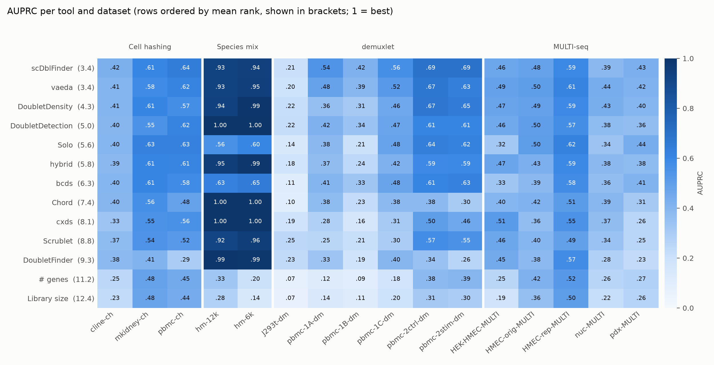

*Figure 1. AUPRC for every method and dataset. Rows are ordered by mean rank (shown in
brackets) and columns are grouped by labeling technology.*

| Method | Mean AUPRC | Mean rank | Mean AUROC | Mean rank (AUROC) |
|---|--:|--:|--:|--:|
| scDblFinder | 0.563 | 3.4 | 0.795 | 3.9 |
| vaeda | 0.552 | 3.4 | 0.785 | 5.1 |
| DoubletDensity | 0.535 | 4.3 | 0.784 | 5.5 |
| DoubletDetection | 0.531 | 5.0 | 0.783 | 5.1 |
| Solo | 0.469 | 5.6 | 0.792 | 4.4 |
| hybrid | 0.512 | 5.8 | 0.787 | 4.9 |
| bcds | 0.468 | 6.3 | 0.785 | 5.8 |
| Chord | 0.452 | 7.4 | 0.765 | 6.7 |
| cxds | 0.462 | 8.1 | 0.763 | 7.9 |
| Scrublet | 0.462 | 8.8 | 0.757 | 9.3 |
| DoubletFinder | 0.421 | 9.3 | 0.735 | 9.3 |
| # genes | 0.292 | 11.2 | 0.729 | 10.8 |
| Library size | 0.264 | 12.4 | 0.714 | 12.1 |

Methods differ overall: Friedman χ² = 103.3 (df 12, p = 1.2·10⁻¹⁶) for AUPRC, and
χ² = 88.2 (p = 1.1·10⁻¹³) for AUROC.

The pairwise picture is less sharp than the ranking suggests (Figure 2). Of 78 AUPRC pairs, 26
are significant after Holm correction. Nineteen of these are a method against a baseline: every
method beats library size except DoubletFinder, and all but Chord and DoubletFinder also beat
# genes. Among the 55 pairs of non-baseline methods, only 7 survive:

- scDblFinder and vaeda each beat bcds and Scrublet;
- DoubletDensity and DoubletDetection each beat Scrublet;
- DoubletDetection beats DoubletFinder.

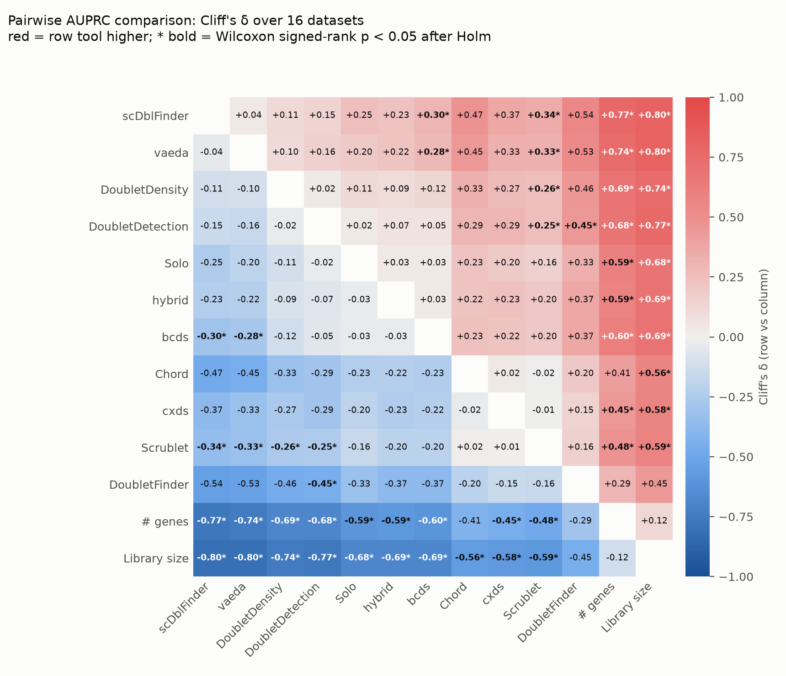

*Figure 2. Pairwise Cliff's δ for AUPRC. A star marks Holm-adjusted Wilcoxon p < 0.05.*

**Paired effect sizes.** Cliff's δ compares the two sets of 16 values without pairing, so
dataset difficulty swamps it: scDblFinder vs vaeda gives δ = 0.04. The paired measures show
the actual comparison ([data.md §18](data.md#18-paired-effect-sizes-and-f1-statistics)):
- scDblFinder vs vaeda: rank-biserial r = 0.40, median paired difference 0.015
  (95% CI −0.011 to 0.026). This is a small, uncertain edge.
- The significant pairs have |r| ≥ 0.88 and CIs that exclude 0, e.g. scDblFinder vs bcds
  (r = 0.99, difference 0.085, CI 0.024–0.102: scDblFinder wins on 15 of 16 datasets).
- Several large but non-significant gaps would probably separate with more datasets, e.g.
  scDblFinder vs DoubletFinder (r = 0.81, difference 0.14, CI 0.02–0.21, Holm p = 0.12).

**Study-level sensitivity.** Averaging within study first (9 blocks) leaves the conclusion
unchanged: Friedman p = 3.5·10⁻⁸, and the order of the top four is the same (mean ranks
scDblFinder 3.4, vaeda 3.6, DoubletDensity 4.0, DoubletDetection 4.9). The 5 PBMC lanes do not
drive the ranking.

**Datasets matter more than methods.** The median AUPRC over methods ranges from 0.19
(J293t-dm, 42 doublets) to 0.96 (hm-6k). On the species mixtures, most methods reach
AUPRC ≥ 0.92, since doublets that mix human and mouse cells are easy. Solo (0.56/0.60) and
bcds (0.63/0.65) are the exception. §3.12 shows that this is mostly a labeling artefact. On
demuxlet and MULTI-seq data, which contain homotypic doublets (two cells of the same type), even
the best method stays near 0.5.

AUROC compresses the differences (0.71–0.80), because the baselines already reach about 0.72:
doublets carry more RNA. AUPRC is the more informative metric here. At fixed identification
rates, the ranking is the same ([data.md §4](data.md#4-fixed-identification-rates)).

### 3.2 Default calls and rate estimation

Users act on calls, not scores. Median F1 at each tool's default threshold
([data.md §5](data.md#5-default-calls)):

| Group | Methods (median F1) |
|---|---|
| Best | scDblFinder 0.49, DoubletDetection 0.49, vaeda 0.49 |
| Middle | Chord 0.45, Solo 0.44, hybrid 0.44, bcds 0.41 |
| Lower | cxds 0.39, DoubletFinder 0.37 |
| Last | Scrublet 0.27 |

The 10 callers differ (Friedman χ² = 36.6, df 9, p = 3.1·10⁻⁵), but only 4 of 45 pairs survive
Holm correction: scDblFinder beats cxds, bcds and hybrid, and hybrid beats cxds.

Scrublet's automatic threshold is very conservative: precision 0.78 but recall 0.16. It calls
about a quarter of the true number of doublets even when given the labeled rate.

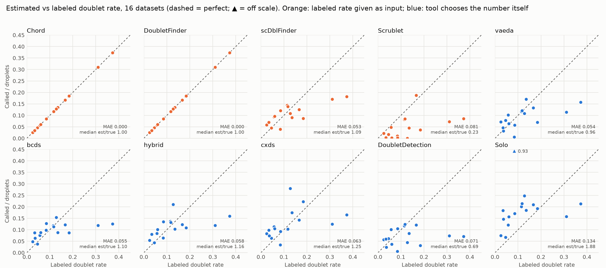

*Figure 3. Estimated vs labeled doublet rate. Orange methods were given the labeled rate.*

Among tools that choose the number of doublets themselves, vaeda was closest
(median est/true 0.96, mean absolute error 0.054), followed by bcds (1.10) and hybrid (1.16).
Solo over-calls (1.88). In the most extreme case it called 467 of 500 droplets on J293t-dm,
because its classifier stopped early. DoubletDetection under-calls (0.69).

Apart from DoubletFinder and Chord, no method follows the high rates: each calls at most 21% of
droplets on HMEC-rep-MULTI and mkidney-ch (labeled rates 0.31 and 0.37). DoubletFinder and
Chord have zero error by construction, since they call exactly round(rate × n). This is only an
advantage if the user knows the rate, which §3.3 tests.

### 3.3 Robustness to the expected rate

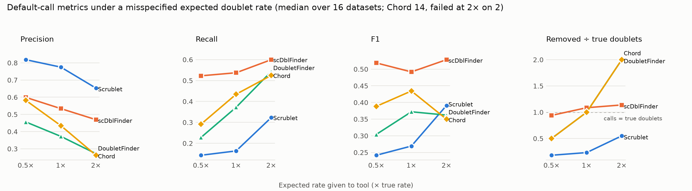

*Figure 4. Default-call metrics when the rate-taking tools are given 0.5×, 1× or 2× the labeled
rate.*

**Misspecified rate (0.5× / 2×).**
- **scDblFinder** treats the rate as a prior and is almost unaffected: the number removed
  changes from 0.94× to 1.14× the true count, and F1 stays at 0.49–0.53.
- **DoubletFinder and Chord** remove exactly the number implied by the rate, so precision and
  recall trade off one for one. Chord's AUPRC also falls at 2× (0.39 → 0.32), because the
  rate enters its training. At 2× it **crashes** on the two datasets where that rate exceeds
  0.6 (`sample()` larger than the population).
- **Scrublet** calls too few doublets at every setting. Its F1 rises when the rate is
  overstated (0.27 → 0.39 at 2×).

The same pattern holds on the 16 simulated datasets, where the labels are complete: scDblFinder
removes 0.84–1.02× the true count at 0.5–2× (F1 0.43–0.49), while DoubletFinder and Chord
remove exactly 0.5× or 2× ([data.md §13](data.md#13-simulated-doublets)).

**Realistic rate.** No user knows the labeled rate. The common alternative is the 10x loading
guideline, 0.8% per 1,000 recovered droplets. It badly underestimates super-loaded or hashed
experiments, for example:

| Dataset | Guideline rate | Labeled rate |
|---|--:|--:|
| J293t-dm | 0.004 | 0.084 |
| cline-ch | 0.064 | 0.184 |
| mkidney-ch | 0.169 | 0.373 |
| HMEC-rep-MULTI | 0.085 | 0.310 |

With these rates ([data.md §23](data.md#23-realistic-expected-rate)):
- **scDblFinder** is unaffected (median F1 0.49 → 0.50).
- **DoubletFinder** removes 0.73× the true count and loses the most (F1 0.37 → 0.32).
- **Chord** (0.45 → 0.40) and **Scrublet** (0.27 → 0.24) also lose.

Ranked by F1 under this realistic setting, scDblFinder leads more clearly (mean rank 2.2;
vaeda 3.7, hybrid 4.3, DoubletDetection 5.2; DoubletFinder last at 8.1; Friedman p = 6·10⁻⁸).
Giving the tools the labeled rate in the main run therefore did not inflate scDblFinder's lead.
It flattered DoubletFinder and Chord.

### 3.4 Agreement between tools

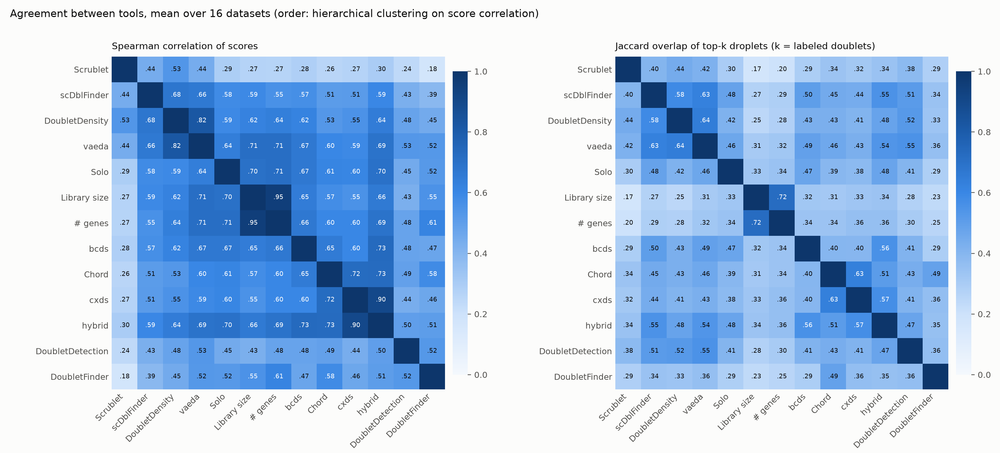

*Figure 5. Spearman correlation of scores and top-k Jaccard overlap, averaged over datasets.*

Scores correlate moderately: the mean Spearman between non-baseline methods is 0.53. Much of
that correlation is shared with library size (vaeda 0.71, Solo 0.70), which reflects how
singlets are ordered rather than agreement on doublets.

At the decision level, overlap is modest. Top-k Jaccard values lie between about 0.3 and 0.6,
and tools from the same family overlap most:
- cxds–hybrid 0.57 (Spearman 0.90);
- Chord–cxds 0.63;
- the scDblFinder–DoubletDensity–vaeda group 0.58–0.64.

Methods therefore make different errors. On a median dataset, at least one method ranks 74% of
the doublets in its top k, against 57% for the best single method. The remaining 26% ("hard
doublets") are found by none of the methods; on J293t-dm the figure is 60%
([data.md §10](data.md#10-agreement)).

### 3.5 Ensembles

The 74% vs 57% gap suggests combining tools. We rank-averaged the scores of every combination of
2–3 non-baseline methods ([data.md §21](data.md#21-ensembles)):

| Ensemble | Mean AUPRC |
|---|--:|
| scDblFinder alone | 0.563 |
| scDblFinder + vaeda | 0.567 |
| DoubletDetection + scDblFinder + vaeda (best on all 16, optimistic) | 0.571 |
| 2 tools, chosen leave-one-dataset-out | 0.560 |
| 3 tools, chosen leave-one-dataset-out | 0.561 |

The best combination gains 0.008 when chosen on all 16 datasets, but nothing once it is chosen
without the held-out dataset (it wins on 6–8 datasets and loses on 8–10; p ≥ 0.38). Simple rank
averaging cannot exploit the different errors, because the tools rarely agree on *which* hard
doublets they find. Chord is a useful contrast: its GBM over cxds, bcds and DoubletFinder
(0.453) is worse than a plain rank average of the same three (0.509).

### 3.6 Runtime, memory and scaling

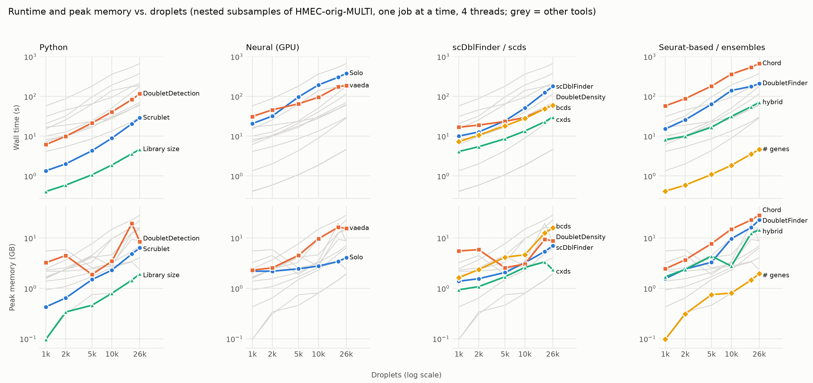

*Figure 6. Wall time and peak memory against droplets, on nested subsamples of HMEC-orig-MULTI
run one job at a time.*

At 26k droplets:

| Method | Wall time | Peak memory |
|---|--:|--:|
| Scrublet | 29 s | 6 GB |
| cxds | 30 s | 2 GB |
| bcds | 60 s | 16 GB |
| DoubletDensity | 63 s | 9 GB |
| hybrid | 70 s | 15 GB |
| DoubletDetection | 116 s | 8 GB |
| scDblFinder | 179 s | 7 GB |
| vaeda (GPU) | 186 s | 16 GB |
| DoubletFinder | 210 s | 23 GB |
| Solo (GPU) | 379 s | 4 GB |
| Chord | 670 s | 28 GB |

No method scales clearly worse than linearly between 5k and 26k droplets; the fitted exponents
are 0.6–1.2. scDblFinder (1.2) and Scrublet (1.1) grow fastest. Memory, not time, is the
practical limit for the Seurat-based methods (Chord's logs show sparse-to-dense conversions of
the count matrix). A rough linear extrapolation gives about 90 GB (DoubletFinder) and 110 GB
(Chord) at 100k droplets. Peak memory is sampled periodically, so short spikes can be missed; treat it as
approximate.

### 3.7 Usability

| Method | Install | Compat. | Ease | Reliab. | Docs | Mean |
|---|--:|--:|--:|--:|--:|--:|
| scDblFinder | 5 | 4 | 5 | 5 | 5 | 4.8 |
| DoubletDetection | 5 | 5 | 5 | 4 | 4 | 4.6 |
| Scrublet, DoubletDensity, cxds | 5 | 5 | 4–5 | 3–4 | 4 | 4.4 |
| bcds / hybrid, Solo | 4–5 | 2–5 | 3–4 | 3–4 | 4 | 3.8 |
| vaeda, DoubletFinder | 1–3 | 3 | 2–4 | 3–4 | 2–3 | 2.8 |
| Chord | 1 | 1 | 3 | 2 | 2 | 1.8 |

The rubric and evidence are in [`docs/usability_scores.md`](../docs/usability_scores.md). Three
tools needed fixes in the wrapper to run at all:
- **bcds/hybrid:** xgboost ≥ 2 moved two fields of the `xgb.cv` result.
- **Chord:** four separate breaks, including functions renamed in DoubletFinder 2.0.4,
  Seurat v5 assays and no declared dependencies.
- **vaeda:** its only PyPI release cannot be imported, and the GitHub version leaves out four
  dependencies.

scDblFinder's scores also changed slightly with the xgboost version (AUPRC 0.222 → 0.211 on
J293t-dm), so benchmark reports must state dependency versions, not only tool versions.

### 3.8 Simulated doublets: what makes a doublet hard

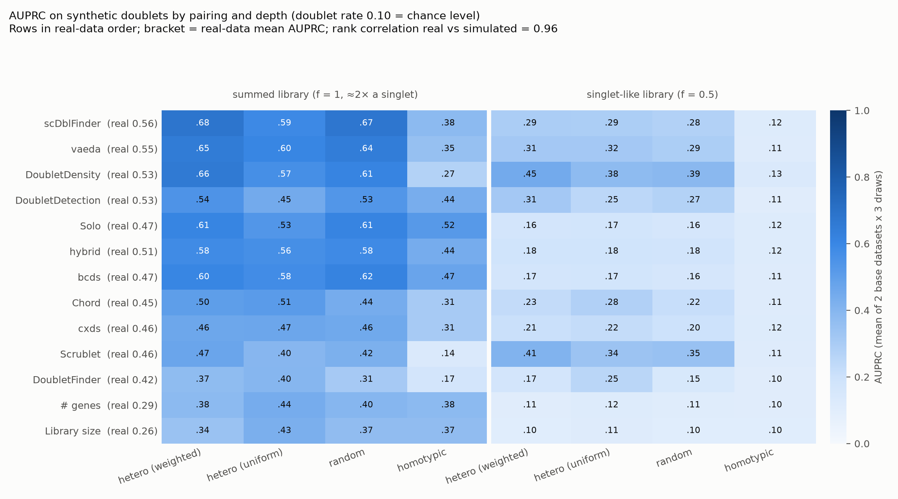

*Figure 7. AUPRC on synthetic doublets made from labeled singlets. Two base datasets
(pbmc-2ctrl-dm, pdx-MULTI), 4 pairings, 2 depths, 3 independent draws; doublet rate 0.10, which
is also the chance level.*

**The simulation reproduces the real-data ranking.** The rank correlation between each method's
mean AUPRC on real and on simulated data is 0.96. On the natural mix (random pairing, summed
library), scDblFinder (0.67) and vaeda (0.64) lead, as on real data
([data.md §13](data.md#13-simulated-doublets)).

**Draw-to-draw noise is small.** The SD between the three draws is 0.01–0.04 for most methods
and scenarios. DoubletFinder is the exception (up to 0.12 with random pairing).

**Partner choice.** Drawing the partner's cluster uniformly ("heterotypic") over-represents rare
cell types. With partners drawn in proportion to abundance, heterotypic doublets are as easy as
random ones or easier (scDblFinder 0.68 vs 0.67 random vs 0.59 uniform), as expected.

**Homotypic doublets separate the methods by mechanism.** When both parents come from the same
cluster, the kNN- and density-based methods collapse:

| Method | Random pairing | Homotypic |
|---|--:|--:|
| Scrublet | 0.42 | 0.14 |
| DoubletFinder | 0.31 | 0.17 |
| DoubletDensity | 0.61 | 0.27 |
| scDblFinder | 0.67 | 0.38 |

Methods that also use sequencing depth hold up best: Solo 0.52, bcds 0.47, hybrid 0.44 and
DoubletDetection 0.44. Even the library-size baselines reach 0.37–0.38 here, because a
homotypic doublet differs from a singlet mainly by its extra RNA.

**At singlet-like depth, most of the signal is gone.** With f = 0.5, the best methods are
DoubletDensity (0.39 random, 0.45 abundance-weighted) and Scrublet (0.35, 0.41). Solo, bcds and
hybrid fall to about 0.16–0.18, because their classifiers rely heavily on library size. Homotypic
doublets at singlet depth are at chance level (0.10–0.13) for every method: they carry neither
an expression nor a depth signal.

**Which depth is realistic?** In the 16 real datasets, labeled doublets have a median library
1.66× that of labeled singlets (range 0.89 on J293t-dm to 1.91). Real doublets are therefore
closer to f = 1 than to f = 0.5, but not at 2×. The f = 1 results are the more relevant ones,
and the depth-driven methods are somewhat flattered by them.

The simulation is additive, like most tools' internal simulations, so it is independent of the
tools only in implementation, not in its generative assumption. §3.10 shows that the exact
doublet model can change the ranking.

### 3.9 Stability across seeds

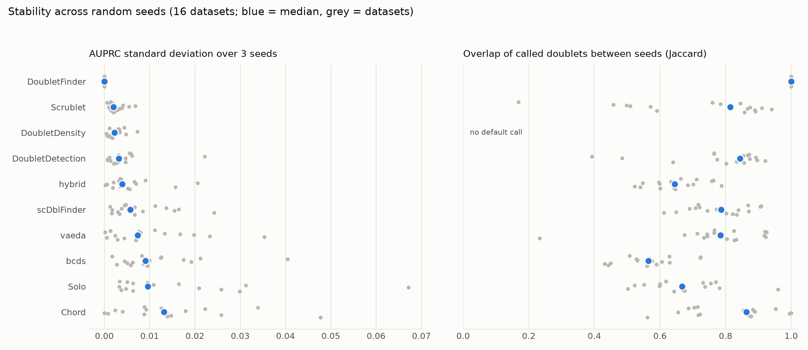

*Figure 8. Spread across three random seeds (0, 1, 2) for the 10 methods with randomness, 16 real
datasets, labeled rate. Left: AUPRC standard deviation; right: mean pairwise Jaccard of the
default calls.*

We reran every method that uses random numbers with seeds 1 and 2 (320 runs; cxds and the
baselines are deterministic). Details are in [data.md §14](data.md#14-stability-across-seeds).

- **The ranking is stable.** scDblFinder, vaeda, DoubletDensity, DoubletDetection and hybrid
  hold ranks 1–5 under every seed. Below them, the mean AUPRCs of Solo, bcds, Scrublet, cxds and
  Chord lie within 0.02 of each other, and their order changes between seeds. Chord moves from
  10th (seed 0) to 8th. The statistical conclusions in §3.1 do not depend on the seed.
- **AUPRC varies little.** The median SD per dataset is 0.002 (Scrublet) to 0.013 (Chord). The
  largest single spreads are Solo on hm-6k (range 0.12) and Chord on HEK-HMEC-MULTI (0.08).
- **The called droplets vary much more than AUPRC.** The median Jaccard overlap of calls
  between seeds is 0.86 (Chord), 0.84 (DoubletDetection), 0.81 (Scrublet) and 0.79
  (scDblFinder, vaeda). It is lower for Solo (0.67), hybrid (0.65) and bcds (0.56): with
  bcds, about half of the doublets called under one seed are not called under another. For
  Scrublet and vaeda, single datasets go down to 0.17 and 0.23, probably because Scrublet's
  automatic threshold falls on different sides of a valley in the score distribution under
  different seeds. A single run's calls should not be treated as definitive.
- **DoubletFinder is identical across seeds.** Seurat's `RunPCA` resets the R random seed to
  42 internally, which overrides the wrapper's seed before DoubletFinder draws its
  artificial doublets. Its variance under real reseeding is therefore not measured here.

One Chord run (pdx-MULTI, seed 1) first failed with a transient error. Its parallel
backend could not open a local socket port. It succeeded unchanged on a rerun.

### 3.10 Independent validation on singletCode data

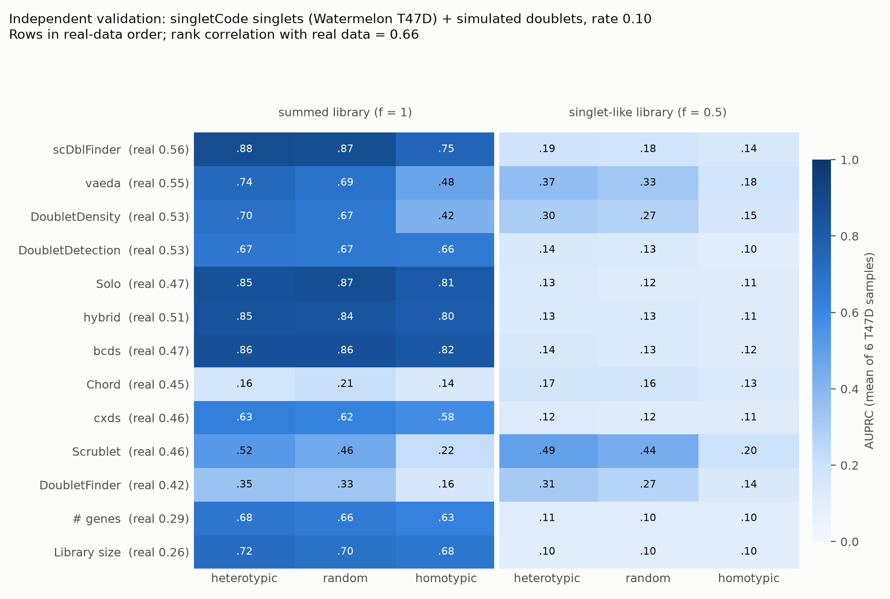

*Figure 9. AUPRC on singletCode singlets (6 Watermelon T47D samples) with simulated doublets,
rate 0.10. Rows in real-data order.*

scDblFinder's parameters were optimized on the 16 benchmark datasets, and both simulation bases
are among them. The singletCode data share neither cells nor tissue with them
([data.md §24](data.md#24-singletcode-independent-validation)).

**Overall, scDblFinder still ranks first.** Over all 36 datasets it has the best mean rank and
the highest mean AUPRC (0.50), ahead of bcds (0.49), Solo (0.48), hybrid (0.48) and vaeda
(0.46) (Friedman p = 1.1·10⁻²¹). Only vaeda and Scrublet are not significantly worse than
scDblFinder (Holm-corrected Wilcoxon over the 36 datasets). The overall ranking agrees only
moderately with the real-data ranking (rank correlation 0.66), because the scenarios favour
different mechanisms:

| Scenario | Best | scDblFinder | Comment |
|---|---|--:|---|
| f = 1, abundance-weighted | scDblFinder 0.88 | 0.88 | Solo, bcds, hybrid 0.85–0.86 |
| f = 1, random | Solo 0.87 | 0.87 | library size alone reaches 0.70 |
| f = 1, homotypic | bcds 0.82 | 0.75 | depth-driven methods lead |
| f = 0.5, abundance-weighted | Scrublet 0.49 | 0.19 | vaeda 0.37, DoubletFinder 0.31 |
| f = 0.5, random | Scrublet 0.44 | 0.18 | vaeda 0.33 |
| f = 0.5, homotypic | Scrublet 0.20 | 0.14 | near chance for all |

The pattern is the one seen on our own simulations (§3.8), only sharper. One cell line has
less transcriptional diversity than PBMCs or tissue, so with summed libraries depth is the
dominant signal (library size alone reaches 0.70), and at singlet depth only the
expression-profile methods work. With 6 samples per scenario, the smallest possible Wilcoxon
p-value is 0.03, so no pairwise difference within a scenario survives Holm correction. Only the
pooled test separates the tools.

**Comparison with Zhang et al. (2024).** On the same 6 samples, Zhang et al. found scDblFinder
worst among four tools (their mean AUPRC 0.12, AUROC 0.39; Scrublet 0.51, hybrid 0.42,
DoubletFinder 0.38). Their doublets were the *average* of two cells, which gives a singlet-like
library, so their setting corresponds to our f = 0.5. There we also find scDblFinder far behind
Scrublet (0.18 vs 0.44). Both results therefore hold: scDblFinder is excellent when doublets
carry extra RNA and weak when they do not. One difference shows how much the doublet model
matters. An averaged doublet keeps every gene detected in either parent, while our binomial
downsampling removes some. hybrid, which uses gene co-detection, reaches AUROC 0.87 on their
doublets but 0.60 on ours.

**Chord fails on these data.** On 12 of the 18 f = 1 datasets, Chord's AUROC is below 0.5: it
ranks true doublets *below* singlets. For example, on T47D-lag-1 (random, f = 1) its AUPRC is
0.06, while the reversed score would give 0.84. This is Chord's design, not a wrapper error:
1. Chord first removes the droplets that its components score highest (`overkill`).
2. It trains its GBM on artificial doublets made by *averaging* two cells, which have a
   singlet-like library.

When the real doublets are much larger than singlets, they lie outside what the GBM was
trained on, and its prediction reverses. The same happens on J293t-dm in the real data
(AUROC < 0.5).

**A label-free pK rule for DoubletFinder.** On the real data, a small fixed pK beat the
automatic BCmvn choice (§3.12). Choosing that rule on the same data would be tuning on the
test set, so we tested it on the singletCode datasets, which played no part in choosing it
([data.md §25](data.md#25-label-free-pk-rule-for-doubletfinder-singletcode)):

| pK setting | Mean AUPRC (36 datasets) | Beats BCmvn on |
|---|--:|--:|
| automatic BCmvn (default) | 0.257 | – |
| fixed 0.005 | 0.304 | 36 / 36 |
| fixed 0.01 | 0.308 | 36 / 36 |

The fixed pK wins on every dataset, in every scenario (sign test p = 3·10⁻¹¹), with gains of
0.05–0.10 on the heterotypic and random scenarios and 0.01–0.02 on the homotypic ones. **For
DoubletFinder users, pK = 0.01 is a better default than BCmvn** on both the benchmark and
independent data. It does not change DoubletFinder's position, though: even with pK = 0.01 it
stays in the bottom group here (0.31 vs 0.36–0.50 for the other non-baseline methods except
Chord).

### 3.11 Downstream impact of doublet removal

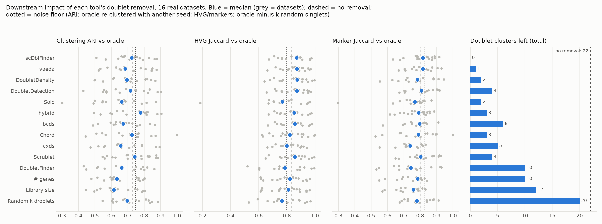

*Figure 10. Downstream analysis after removing each tool's calls, compared with the oracle
(labeled doublets removed). 16 real datasets.*

For every dataset we removed each tool's calls and ran a standard scanpy analysis (2,000 HVGs,
PCA, Leiden), then compared it with the same analysis after removing exactly the labeled
doublets ([data.md §15](data.md#15-downstream-impact)). Two references give the noise floor:
removing k random droplets instead of the tool's calls, and removing k random singlets on top of
the oracle (k = the number of labeled doublets).

- **Spurious doublet clusters.** Without any removal, the 16 datasets contain 22 clusters
  made up mostly of doublets; removing k random droplets leaves 20. After scDblFinder none
  remain; vaeda leaves 1, and Solo and DoubletDensity 2. DoubletFinder (10) and the baselines
  (10–12) leave about half. This is the clearest downstream benefit of doublet detection.
- **HVGs and markers.** Removing k random singlets from the oracle data already lowers the HVG
  overlap with the oracle to 0.80, and k random droplets to 0.76. Against this floor, most tools
  sit between 0.82 and 0.87, and the differences between them (e.g. vaeda 0.87 vs Chord 0.82)
  are of the same size as the noise of removing k cells. DoubletFinder (0.79) and Solo (0.77),
  which remove many singlets, are at the floor. Marker-gene overlap shows the same pattern in a
  narrower range (0.74–0.82; floor 0.78–0.82).
- **Clustering ARI is not informative.** Re-clustering the oracle data with another seed already
  gives only ARI 0.75, so Leiden's own variability is as large as any tool's effect.
- **Trajectory inference** was not evaluated: none of the 16 datasets has a ground-truth
  trajectory.

### 3.12 Comparison with Xi & Li (2021) and label noise

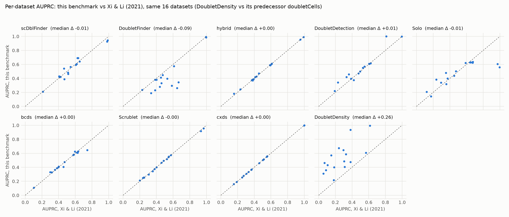

*Figure 11. Per-dataset AUPRC in this benchmark against Xi & Li (2021), same 16 datasets.*

Xi & Li's per-dataset results (Zenodo 4444303) allow a direct comparison on identical data
([data.md §22](data.md#22-comparison-with-xi--li-2021)):

| Method | Mean AUPRC, Xi & Li | Mean AUPRC, here | Per-dataset Spearman | Datasets with \|Δ\| > 0.1 |
|---|--:|--:|--:|--:|
| scDblFinder | 0.566 | 0.563 | 0.93 | 0 |
| DoubletFinder | 0.537 | 0.421 | 0.61 | 8 |
| hybrid | 0.509 | 0.512 | 0.99 | 0 |
| DoubletDetection | 0.508 | 0.531 | 0.96 | 2 |
| Solo | 0.502 | 0.469 | 0.85 | 4 |
| bcds | 0.472 | 0.468 | 0.98 | 0 |
| Scrublet | 0.464 | 0.462 | 1.00 | 0 |
| cxds | 0.461 | 0.462 | 1.00 | 0 |
| doubletCells → DoubletDensity | 0.266 | 0.535 | 0.69 | 12 |

**Six of the eight comparable methods reproduce.** scds, Scrublet and scDblFinder match to
within 0.005 on average. DoubletDetection gained slightly in newer versions. DoubletDensity is the successor of
doubletCells, with a different algorithm, and doubled its AUPRC. The two large gaps are
DoubletFinder and Solo.

**DoubletFinder: pK explains about half the gap.** It is 0.12 below Xi & Li on average and more
than 0.1 lower on 8 datasets, mostly PBMC demuxlet data (pbmc-2stim-dm −0.39, pbmc-2ctrl-dm
−0.32, pbmc-ch −0.29). A fixed-pK sweep on all 16 datasets
([data.md §12](data.md#12-doubletfinder-pk-sensitivity)) gives:

| pK setting | Mean AUPRC |
|---|--:|
| fixed 0.005 | 0.477 |
| fixed 0.01 | 0.482 |
| fixed 0.05 | 0.444 |
| fixed 0.3 | 0.348 |
| best fixed pK per dataset (oracle) | 0.488 |
| automatic BCmvn (main run) | 0.421 |
| Xi & Li (2021) | 0.537 |

AUPRC is lower at pK 0.3 than at 0.01 on 14 of 16 datasets; only the species mixtures prefer a
large pK. BCmvn
picked pK ≥ 0.08 on 13 datasets, which cost 0.06 on average. A fixed pK of 0.01 would move
DoubletFinder from rank 9.3 to 7.5. Even the best pK per dataset, chosen with the labels, stays
0.05 below Xi & Li, though. The rest of the gap is a change in DoubletFinder or its Seurat
preprocessing since 2020, which we could not isolate. Our earlier draft attributed the gap
"mostly" to pK; that was too strong.

**Solo: the reimplementation differs on the species mixtures.** Our Solo is 0.44 and 0.37
lower on hm-12k and hm-6k, but 0.08–0.15 *higher* on the pbmc-1A/B/C lanes. The species
mixtures also expose a labeling problem:

- **Unlabeled doublets.** In hm-12k and hm-6k only human–mouse doublets are labeled. With a
  species fraction of 0.49, about as many same-species doublets are expected as labeled ones
  (731 in hm-12k, 171 in hm-6k), and they are all labeled singlets
  ([data.md §19](data.md#19-label-noise-species-mixtures)).
- **Solo and bcds find them.** Among Solo's top-k droplets on hm-12k, 287 are labeled
  singlets; their median library is 1.93× that of their own species' singlets, and 85% exceed
  1.6× (vs 8.5% of all singlets). bcds is similar (296, 2.04×, 90%). These are almost certainly
  real within-species doublets that are scored as false positives.
- **Expression-based methods do not find them.** cxds, Chord and DoubletDetection put at most
  6 labeled singlets in their top k, because a within-species doublet does not look
  cross-species.

The species-mix AUPRC therefore penalizes the tools that also find homotypic doublets. This
label noise is not tool-neutral. It applies, more weakly, to every hashing and demuxlet dataset,
where same-sample doublets are labeled singlets.

But label noise does not explain the gap to Xi & Li: their original Solo reached 0.995 and 0.972
on the same labels. Changing our Solo's HVG count does not close it (all genes: 0.47/0.43; 5,000
HVGs: 0.54/0.56; 2,000 HVGs: 0.56/0.60), and AUROC stays at 0.95–0.99. The scvi-tools version
ranks the unlabeled high-RNA droplets above the cross-species doublets, while the original
apparently did not.

**The original Solo reproduces Xi & Li; the gap is the reimplementation.** We ran the original
package (solo-sc 0.6 on scvi 0.6.8, the repository's example parameters, all genes; only torch
is newer) on all 16 datasets ([data.md §26](data.md#26-original-solo-solo-sc-06)):

| | Mean AUPRC | hm-12k | hm-6k | pbmc-1A/1B/1C-dm |
|---|--:|--:|--:|--:|
| Xi & Li (2021) | 0.502 | 0.995 | 0.972 | 0.24 / 0.12 / 0.35 |
| original Solo, here | 0.495 | 0.941 | 0.967 | 0.22 / 0.16 / 0.31 |
| scvi-tools Solo (main run) | 0.469 | 0.558 | 0.605 | 0.38 / 0.21 / 0.48 |

The original matches Xi & Li to within 0.023 AUPRC on average (largest difference 0.054, on
hm-12k; the original CLI has no seed option, so single runs vary by about this much). It
reproduces both the high species-mix values and the low pbmc-1A/B/C values. The data, the labels
and our preprocessing are therefore not the cause; the scvi-tools version scores differently.
Its mean is only 0.03 lower, because it loses on the species mixtures and gains on the
pbmc-1 lanes. Both versions train on the same counts, so the cause lies inside the
reimplementation (model, doublet simulation or training defaults), which we did not isolate
further. The ranking of the main benchmark uses the current scvi-tools version, which is
what users install today.

### 3.13 Lineage co-expression (PBMC data)

In the 6 PBMC datasets, a droplet that co-expresses markers of two exclusive lineages
(T: CD3E/CD3D; B: CD79A/MS4A1; myeloid: CD14/LYZ) is very likely a heterotypic doublet. This
gives evidence that is independent of the labels ([data.md §20](data.md#20-lineage-co-expression)):

- **Co-expressing droplets are rare and are doublets.** Only 0.3% of labeled singlets
  co-express, against 5.3% of labeled doublets. Of 589 co-expressing droplets, 189 are labeled
  singlets: the labels miss about a third of them (median recall of the labels 0.65).
- **The methods find them.** Of all co-expressing droplets, scDblFinder and vaeda rank 90% in
  their top k, hybrid 88%, bcds and cxds 84%, Chord 80%. Scrublet (71%) and DoubletFinder (47%)
  find the fewest, below the library-size baseline (59%) in DoubletFinder's case.
- **This confirms the ranking for heterotypic doublets.** It says nothing about homotypic
  doublets, which by definition do not co-express.

## 4. Discussion

**Recommendation.** For routine use, scDblFinder is the best overall choice: top accuracy on
the benchmark and on independent data, good default calls, insensitive to the rate setting,
fast and easy to install. vaeda and DoubletDetection are about as accurate. DoubletDetection is
an easy Python alternative, but its default threshold under-calls. vaeda is hard to install.
Where a fast score is enough, DoubletDensity (scores only) and cxds are cheap.

**When to choose something else.** scDblFinder's lead rests partly on the extra RNA of
doublets. Where doublets are not larger than singlets, Scrublet, vaeda and DoubletDensity do
better: for example after strong depth normalisation, in nuclei, or with a capture that
saturates per droplet. J293t-dm, the one real dataset where doublets are *smaller* than singlets
(ratio 0.89), is also the hardest for every method. Running a second, expression-based method
and inspecting the droplets both flag is cheap insurance.

**Expected rate.** Tools that call exactly rate × n (DoubletFinder, Chord) are only as good as
the user's rate estimate. With the "0.8% per 1,000 cells" rule they miss most doublets on
super-loaded or hashed experiments (rates up to 37% here). scDblFinder's prior-based use of the
rate is the robust design.

**Comparison with Xi & Li (2021).** Most tools reproduce. Two rankings changed: DoubletFinder
fell from second to ninth, and Solo's results changed in its move to scvi-tools (the original
package, run on our data, still reproduces Xi & Li). A benchmark can
therefore only rank tool *versions*, and re-running old benchmarks on current versions is
worthwhile. The xgboost-dependent tools (bcds, hybrid, Chord, scDblFinder) also show that a
dependency change can break a tool or shift its scores without any change to the tool.

**Comparison with Zhang et al. (2024).** Their ranking (scDblFinder last) and ours (scDblFinder
first) are both correct for their doublet model. A benchmark built on simulated doublets
measures the simulation as much as the tools. The real labeled doublets here have 1.66× a
singlet's library, which is why scDblFinder's real-data lead holds.

**Labels.** Experimental labels miss same-sample doublets. The co-expression analysis estimates
that about a third of heterotypic PBMC doublets are unlabeled, and the species mixtures
contain about as many unlabeled as labeled doublets. Precision is therefore underestimated for
every method, and most for the methods that also find homotypic doublets (Solo, bcds).

**Limitations.**
- **Defaults only.** Tuned settings could change the ranking, as DoubletFinder's pK shows.
  No homotypic adjustment for DoubletFinder; Solo with default early stopping.
- **16 datasets from 4 studies** limit statistical power: only large effects survive the Holm
  correction across 78 pairs. Averaging within study gives the same ranking.
- **Independent validation is one cell line**, with simulated doublets. It confirms that
  scDblFinder's lead does not come from tuning on the benchmark, but singletCode-identified
  doublets in more tissues would be stronger evidence.
- **Simulation is additive.** The doublet model (sum, downsampled sum, average) changes the
  ranking (§3.10).
- **Three seeds** show the spread but do not estimate it precisely. DoubletFinder's seed has no
  effect, because Seurat resets the random seed.
- **Scaling** was measured up to 26k droplets. Current experiments reach 100k–200k droplets;
  the memory of the Seurat-based tools (§3.6) suggests that they would need a large-memory node.
- **Downstream** uses one standard pipeline and no trajectory or DE ground truth.
- **Memory** is sampled periodically. **Runtimes** come from one machine, and the GPU
  methods depend on the GPU.

## 5. Reproducibility

Everything needed is in the repository
([github.com/cahidenes/doublet-detection-benchmark](https://github.com/cahidenes/doublet-detection-benchmark)).

```bash
# 1. Environments: exact versions are in envs/lock/*.yaml; envs/*.yaml are the loose specs
M=~/miniforge3/bin/mamba
$M env create -f envs/lock/dbl-py.yaml
$M env create -f envs/lock/dbl-r.yaml
$M env create -f envs/lock/dbl-vaeda.yaml
$M run -n dbl-r Rscript envs/install_r_github.R          # DoubletFinder @1b244d8, Chord @00ac9a1
$M run -n dbl-vaeda pip install --no-deps git+https://github.com/kostkalab/vaeda@7b4979c12d

# 2. Data: Xi & Li (Zenodo 4062232, ~750 MB) and their result table (Zenodo 4444303);
#    singletCode (figshare 25478680, 5.5 GB download, ~0.7 GB kept)
scripts/download_data.sh --with-singletcode
PY=~/miniforge3/envs/dbl-py/bin/python
$PY scripts/prepare_singletcode.py                       # -> data/processed/wm-T47D-*
for b in pbmc-2ctrl-dm pdx-MULTI; do                     # simulated doublets, 3 draws
  for s in 0 1 2; do $PY scripts/simulate_doublets.py "$b" --seed $s; done
done
for b in $(ls data/processed | grep ^wm-); do
  $PY scripts/simulate_doublets.py "$b" --pairings random homotypic heteroweighted
done

# 3. Main run + rate robustness: 336 runs, about 7 h of compute, ~3 h wall time with --cores 8
SMK="$HOME/miniforge3/envs/dbl-py/bin/snakemake -s workflow/Snakefile --resources gpu=1 heavy=1"
$SMK --cores 8 --keep-going

# 4. Scaling: nested subsamples, one job at a time (~1.5 h)
$PY scripts/subsample.py HMEC-orig-MULTI 1000 2000 5000 10000 20000 26426
DS=$(printf 'scale-HMEC-orig-MULTI-n%s,' 1000 2000 5000 10000 20000 26426)
$SMK --cores 4 --keep-going --config "datasets=[${DS%,}]" 'rate_multipliers=[1.0]' \
     metrics_out=results/scaling_metrics.tsv

# 5. Seeds 1-2 (~4.5 h); realistic rate, simulations, singletCode, rate robustness on
#    simulations (~8 h)
scripts/run_stretch.sh            # -> results/stability_metrics.tsv (and sim_metrics.tsv)
scripts/run_final.sh              # -> results/{heuristic,sim,singletcode,sim_robustness}_metrics.tsv

# 6. Sensitivity analyses: DoubletFinder pK on the 16 datasets (~1.5 h) and on singletCode (~2 h)
analysis/df_pk_sensitivity.sh
DATASETS="$(ls data/processed | grep ^sim-wm-)" PKS="0.005 0.01" TAG=_singletcode analysis/df_pk_sensitivity.sh
#    Original Solo on the 16 datasets, GPU, ~10 min each (env dbl-solo0g, see its docstring)
~/miniforge3/envs/dbl-solo0g/bin/python analysis/solo_original.py $(ls data/processed | grep -v -e "^scale-" -e "^sim-" -e "^sc-" -e "^wm-")

# 7. All statistics, figures and report/data.md (downstream.py alone takes ~10 min)
analysis/run_all.sh
```

Additional notes:
- **Seeds and settings** are in `config/config.yaml`: seed 0, rate multipliers 0.5/1/2.
- **Committed results:** all `results/*_metrics.tsv` tables, `results/stats/`, `results/bench/`,
  `results/figures/`, `results/sensitivity/` and `results/reference/`. Steps 3–6 can be
  skipped to re-analyse the committed results, except `analysis/agreement.py`, `stability.py`,
  `downstream.py`, `label_noise.py`, `lineage.py` and `ensemble.py`, which need the per-droplet
  predictions (`results/pred/`, not in git). `downstream.py --plot-only` redraws its figure from
  the committed table.
- **Expected differences on a rerun:** GPU methods (Solo, vaeda) are not bit-reproducible
  across hardware or CUDA versions. scDblFinder depends on the xgboost version (pinned to
  2.1.4).
- **Install and run problems** are logged with dates in `docs/usability_log.md`.

## 6. Further work

1. **Real singletCode doublets in more tissues.** Use datasets where both singlets and doublets
   are identified from barcodes, instead of simulated doublets, and tissues beyond one cell line.
2. **Scaling to 100k–200k droplets**, including out-of-memory failures, which are themselves a
   usability finding.
3. **More seeds, with real reseeding of DoubletFinder.** Use 5–10 seeds to estimate the spread
   of the default calls precisely. For DoubletFinder, pass the seed through Seurat's `seed.use`.
4. **Downstream with ground truth.** Measure false-positive DE genes between clusters, using
   hashing labels to define the true clusters. Measure trajectory inference on a dataset with a
   known trajectory, as in Xi & Li.
5. **A depth-aware ensemble.** Simple rank averaging did not help (§3.5), but the methods are
   complementary by doublet depth (§3.10). A combination that weighs depth-driven and
   expression-driven scores by the observed doublet/singlet depth ratio may.
6. **Newer data and tools.** Add recent multiplexed datasets (10x Flex, OCM), single-nucleus
   and ATAC data (scDblFinder, AMULET), and newer tools as they appear. The pipeline needs one
   wrapper and one config line per tool.
7. **Better memory measurement.** Use cgroup peak memory (`memory.peak`) instead of sampled
   RSS.

## References

- Xi, N. M. & Li, J. J. Benchmarking computational doublet-detection methods for single-cell
  RNA sequencing data. *Cell Systems* 12, 176–194 (2021).
- Zhang, Z., Melzer, M. E. et al. Synthetic DNA barcodes identify singlets in scRNA-seq datasets
  and evaluate doublet algorithms. *Cell Genomics* 4, 100592 (2024).
- Wolock, S. L., Lopez, R. & Klein, A. M. Scrublet: computational identification of cell
  doublets in single-cell transcriptomic data. *Cell Systems* 8, 281–291 (2019).
- McGinnis, C. S., Murrow, L. M. & Gartner, Z. J. DoubletFinder: doublet detection in single-cell
  RNA sequencing data using artificial nearest neighbors. *Cell Systems* 8, 329–337 (2019).
- Germain, P.-L., Lun, A., Garcia Meixide, C., Macnair, W. & Robinson, M. D. Doublet
  identification in single-cell sequencing data using scDblFinder. *F1000Research* 10, 979
  (2021).
- Bais, A. S. & Kostka, D. scds: computational annotation of doublets in single-cell RNA
  sequencing data. *Bioinformatics* 36, 1150–1158 (2020).
- Bernstein, N. J. et al. Solo: doublet identification in single-cell RNA-seq via
  semi-supervised deep learning. *Cell Systems* 11, 95–101 (2020).
- Gayoso, A. & Shor, J. DoubletDetection. Zenodo (2018).
- Schriever, H. & Kostka, D. Vaeda computationally annotates doublets in single-cell RNA
  sequencing data. *Bioinformatics* 39, btac720 (2023).
- Xiong, K.-X. et al. Chord: an ensemble machine learning algorithm to identify doublets in
  single-cell RNA sequencing data. *Communications Biology* 5, 510 (2022).
- Stoeckius, M. et al. Cell hashing with barcoded antibodies enables multiplexing and doublet
  detection for single cell genomics. *Genome Biology* 19, 224 (2018).
- Kang, H. M. et al. Multiplexed droplet single-cell RNA-sequencing using natural genetic
  variation. *Nature Biotechnology* 36, 89–94 (2018).
- McGinnis, C. S. et al. MULTI-seq: sample multiplexing for single-cell RNA sequencing using
  lipid-tagged indices. *Nature Methods* 16, 619–626 (2019b).
- Zheng, G. X. Y. et al. Massively parallel digital transcriptional profiling of single cells.
  *Nature Communications* 8, 14049 (2017).
- Romano, J. et al. Appropriate statistics for ordinal level data: should we really be using
  t-test and Cohen's d for evaluating group differences on the NSSE and other surveys?
  Annual meeting of the Florida Association of Institutional Research (2006).
