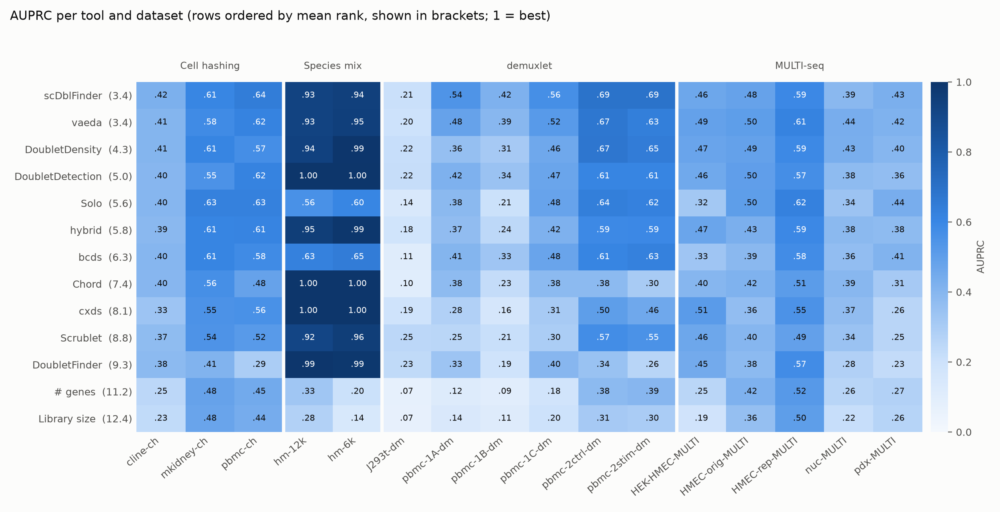
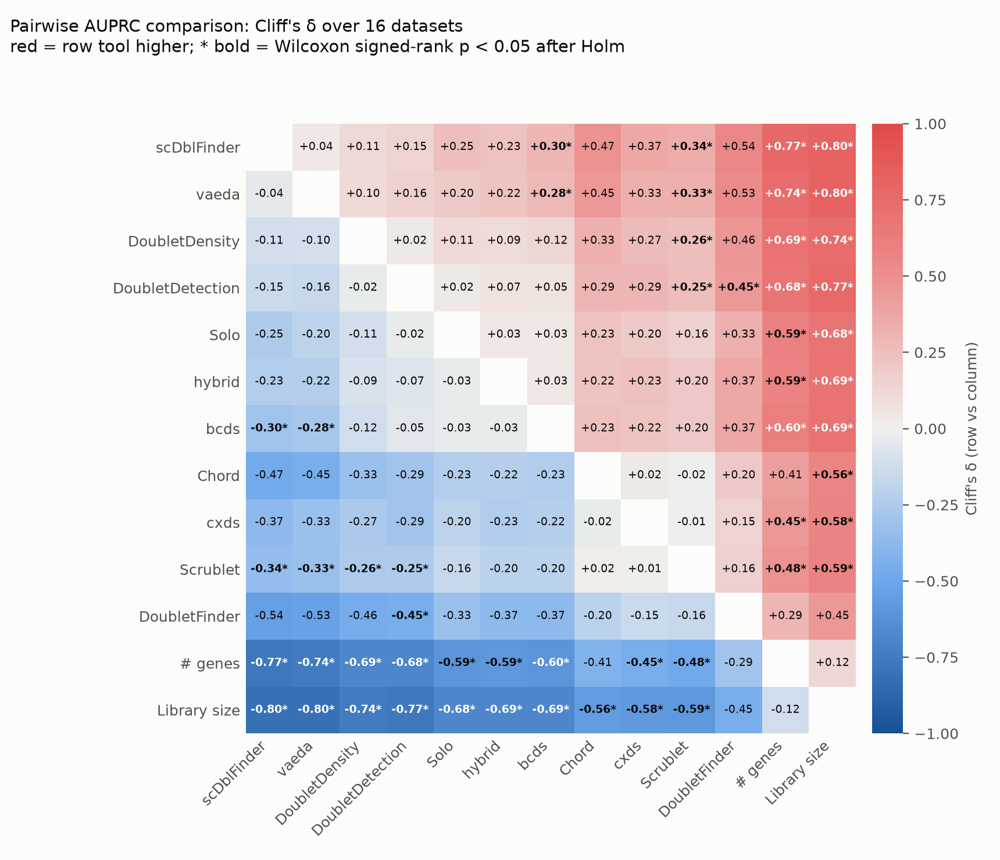
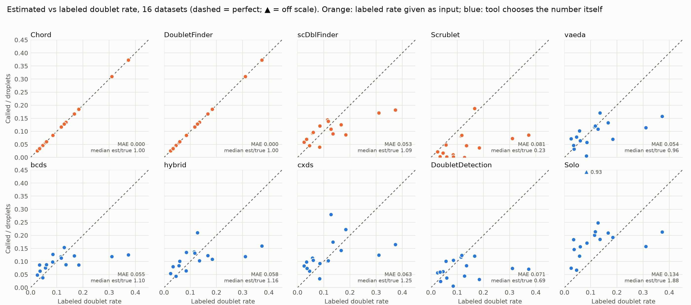
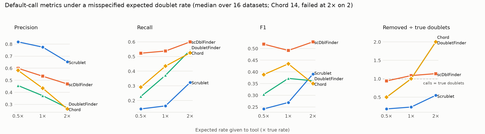
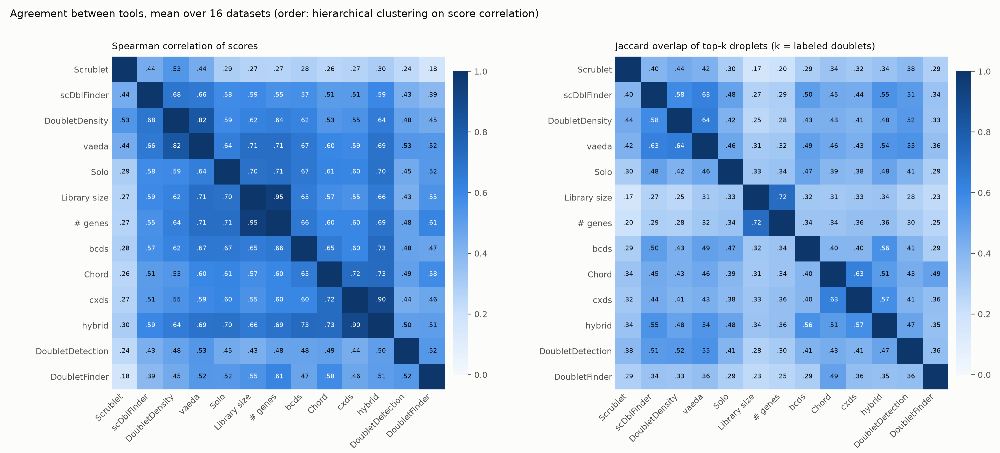
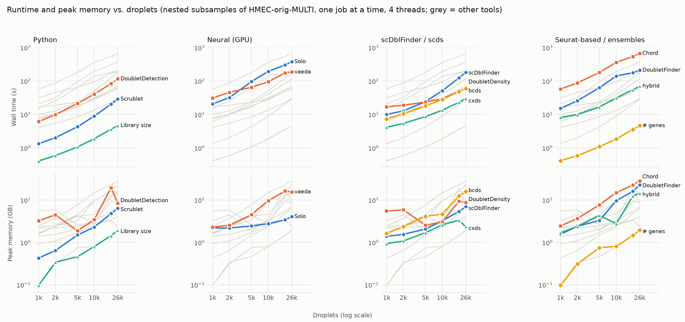
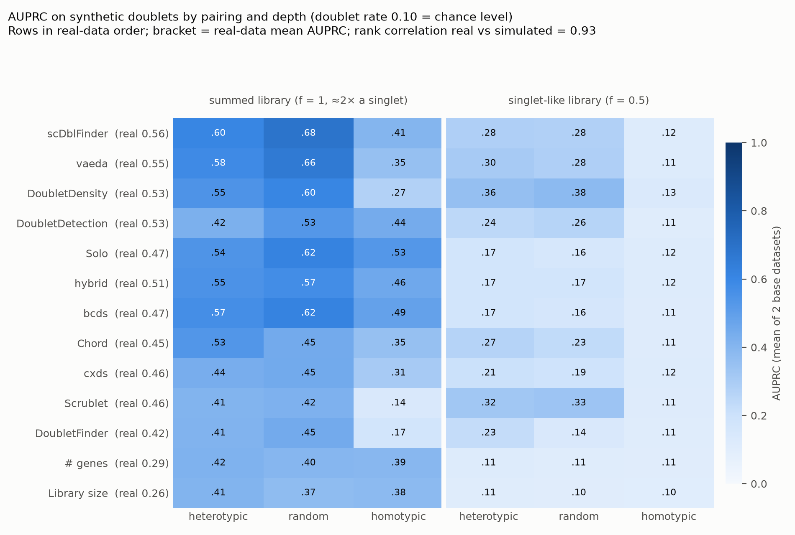
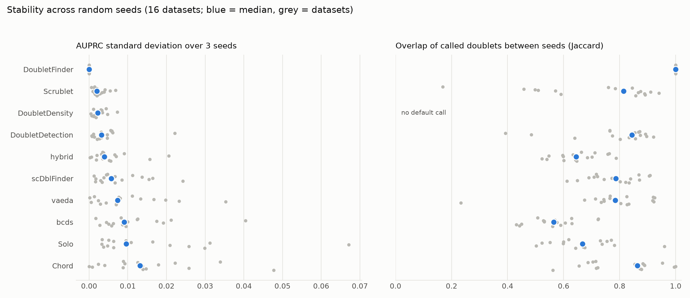
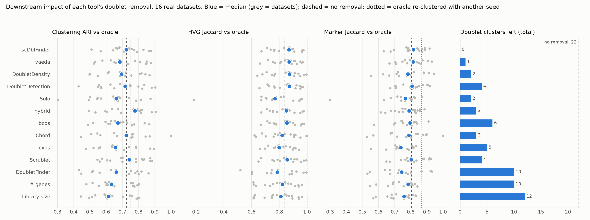

# Benchmarking computational doublet-detection methods for scRNA-seq data

**Cahid Enes Keleş** · Istanbul Technical University · *Draft, November 2026*

> **Status: draft.** All numbers come from the committed results and can be regenerated with
> `analysis/run_all.sh`. Every table behind the text is in [`data.md`](data.md). Points still
> open are marked **[TODO]**.

## Abstract

Droplet-based single-cell RNA sequencing produces doublets: droplets that captured two cells.
Many tools try to find them computationally, but the most recent independent benchmark
(Xi & Li, 2021) predates several of them, and the older tools now run on a changed software
stack.

We benchmarked 11 methods (8 tools; scds counted as three) and 2 trivial baselines on the 16
real datasets of Xi & Li, whose doublets are labeled experimentally. Every method ran with its
default parameters. We measured accuracy, default calls, doublet-rate estimation, robustness to
a misspecified expected rate, agreement between tools, runtime, memory, scaling and usability.

**scDblFinder** had the highest mean AUPRC (0.563), the most accurate default calls (median
F1 0.49) and the best behaviour under a wrong expected rate, and it is fast (3 min for 26k
droplets). **vaeda** (0.552), **computeDoubletDensity** (0.535) and **DoubletDetection**
(0.531) were statistically indistinguishable from it. Methods differed significantly overall
(Friedman p = 1.2·10⁻¹⁶), but only 7 of the 55 pairwise comparisons between non-baseline
methods survived Holm correction. Differences between datasets were much larger than
differences between methods.

Three practical findings stand out:
1. DoubletFinder's low rank is mostly caused by its automatic pK selection.
2. Chord and bcds/hybrid only run with compatibility fixes.
3. Tools that call exactly the user-supplied number of doublets inherit any error in that number.

Three further analyses support these results:
- **Simulated doublets.** On synthetic doublets of known composition, the ranking matches the
  real-data ranking (rank correlation 0.93). The kNN-based methods fail on homotypic doublets.
  No method detects homotypic doublets at singlet depth.
- **Random seeds.** With three seeds, the top five methods keep their ranks. Run-to-run AUPRC
  spread (median SD ≤ 0.013) is far smaller than the differences between them.
- **Downstream analysis.** Removing scDblFinder's calls eliminates all 22 doublet-driven
  clusters. Solo and DoubletFinder remove many singlets and make HVG selection worse than not
  removing anything.

## 1. Introduction

A doublet looks like a single cell with an unusual, mixed expression profile. It can show up as a
spurious intermediate state or cluster, and it can bias differential expression. Experimental
removal (cell hashing, genotype demultiplexing, MULTI-seq) is not always possible, so
computational detection is a standard preprocessing step.

Xi & Li (2021) compared nine methods on 16 labeled datasets. Since then:
- new methods appeared (Chord, an ensemble; vaeda, a variational autoencoder);
- Solo moved into scvi-tools;
- the R ecosystem changed underneath several tools (Seurat v5, xgboost ≥ 2).

This project re-evaluates the field on the same real data. The aims are:
1. an updated ranking with paired statistics;
2. the dimensions users care about beyond AUPRC: default calls, rate robustness, speed,
   memory and how hard each tool is to install and run;
3. a fully reproducible pipeline (Snakemake, pinned environments) that new tools can be added to.

## 2. Methods

### 2.1 Methods compared

| Method | Version | Language | Principle | Expected rate input |
|---|---|---|---|---|
| Scrublet | 0.2.3 | Python | kNN on simulated doublets | yes |
| DoubletDetection | 4.3.0.post1 | Python | Boosted clustering with synthetic doublets | no |
| Solo | scvi-tools 1.4.2 | Python | Classifier on an scVI latent space | no |
| vaeda | 0.0.30 (GitHub `7b4979c`) | Python | VAE + PU learning | no |
| scDblFinder | 1.23.4 | R | Gradient boosting on kNN features of simulated doublets | yes (prior) |
| DoubletDensity | scDblFinder 1.23.4 | R | Density of simulated doublets (`computeDoubletDensity`) | no; scores only |
| cxds / bcds / hybrid | scds 1.22.0 | R | Gene co-expression / boosting / their combination | no (`estNdbl`) |
| DoubletFinder | 2.0.6 (GitHub `1b244d8`) | R | pANN in PC space, pK chosen by BCmvn | yes (nExp) |
| Chord | 2.0.1 (GitHub `00ac9a1`) | R | GBM ensemble of DoubletFinder, bcds, cxds | yes |
| Library size, # genes | – | Python | Baselines: doublets carry more RNA | no |

Wrapper choices follow each tool's README or vignette:
- **DoubletFinder:** 10 PCs, pN = 0.25, pK chosen by the maximum BCmetric, nExp = round(rate × n),
  no homotypic adjustment (it needs cell-type annotations).
- **Solo:** 2,000 HVGs (seurat_v3), then SCVI, then SOLO.

The full choices are documented at the top of each file in `methods/`. Tool source code was
never edited. Where a tool no longer runs on current dependencies, the fix lives in the wrapper
(README, *Compatibility shims*).

### 2.2 Data

We used the 16 datasets with experimentally labeled doublets from Xi & Li (2021)
(Zenodo [4062232](https://zenodo.org/records/4062232)). They come from four technologies:
- cell hashing (3 datasets);
- species mixture (2);
- demuxlet (6);
- MULTI-seq (5).

They contain 500–26,426 droplets, with doublet rates of 2.5–37.3% ([data.md §1](data.md#1-datasets)).

### 2.3 Evaluation

The main run gives every method its defaults and, where it takes one, the labeled doublet rate
(seed 0). The metrics follow the proposal:

| # | Metric | Definition |
|---|---|---|
| 1 | AUPRC, AUROC | From the continuous score (higher = more doublet-like) |
| 2 | Fixed identification rates | Precision, recall and TNR when the top 10/20/40% of droplets are called |
| 3 | Default calls | Precision, recall and F1 of the tool's own threshold |
| 4 | Rate estimation | Called ÷ droplets compared with the labeled rate |
| 5 | Rate robustness | Rate-taking tools rerun at 0.5× and 2× the labeled rate |
| 6 | Agreement | Spearman correlation of scores; Jaccard overlap of each tool's top-k droplets (k = labeled doublets) |
| 7–9 | Runtime, memory, scaling | Snakemake `benchmark` (wall time, peak RSS); nested stratified subsamples of HMEC-orig-MULTI (1k–26k droplets), run one job at a time |
| 10 | Usability | Rubric scores (1–5) from a dated installation and run log |

**Statistics.** A Friedman test over methods (blocks = 16 datasets) is followed by all pairwise
two-sided Wilcoxon signed-rank tests, Holm-corrected within each metric. Effect sizes are
Cliff's δ, with Romano et al. thresholds.

**Compute.** One workstation: Intel Core Ultra 7 265K (20 cores), 62 GB RAM, one NVIDIA
RTX 5070 Ti. Each job used 4 threads. The main run took 3.7 h of compute; with the
robustness runs, 7.1 h.

## 3. Results

### 3.1 Accuracy: a top group of four, large differences between datasets



*Figure 1. AUPRC for every method and dataset. Rows are ordered by mean rank (shown in
brackets) and columns are grouped by labeling technology.*

| Method | Mean AUPRC | Mean rank | Mean AUROC | Mean rank (AUROC) |
|---|--:|--:|--:|--:|
| scDblFinder | 0.563 | 3.4 | 0.795 | 3.9 |
| vaeda | 0.552 | 3.4 | 0.785 | 5.1 |
| DoubletDensity | 0.535 | 4.3 | 0.784 | 5.5 |
| DoubletDetection | 0.531 | 5.0 | 0.783 | 5.1 |
| Solo | 0.469 | 5.6 | 0.792 | 4.4 |
| hybrid | 0.512 | 5.8 | 0.787 | 4.9 |
| bcds | 0.468 | 6.3 | 0.785 | 5.8 |
| Chord | 0.452 | 7.4 | 0.765 | 6.7 |
| cxds | 0.462 | 8.1 | 0.763 | 7.9 |
| Scrublet | 0.462 | 8.8 | 0.757 | 9.3 |
| DoubletFinder | 0.421 | 9.3 | 0.735 | 9.3 |
| # genes | 0.292 | 11.2 | 0.729 | 10.8 |
| Library size | 0.264 | 12.4 | 0.714 | 12.1 |

Methods differ overall: Friedman χ² = 103.3 (df 12, p = 1.2·10⁻¹⁶) for AUPRC, and
χ² = 88.2 (p = 1.1·10⁻¹³) for AUROC.

The pairwise picture is less sharp than the ranking suggests (Figure 2). Of 78 AUPRC pairs, 26
are significant after Holm correction. Nineteen of these are a method against a baseline: every
method beats library size except DoubletFinder, and all but Chord and DoubletFinder also beat
# genes. Among the 55 pairs of non-baseline methods, only 7 survive:

- scDblFinder and vaeda each beat bcds and Scrublet;
- DoubletDensity and DoubletDetection each beat Scrublet;
- DoubletDetection beats DoubletFinder.

Several large but non-significant gaps would probably separate with more datasets, for example
scDblFinder vs DoubletFinder (δ = 0.54, Holm p = 0.12) and vaeda vs Chord (δ = 0.45, Holm
p = 0.052). The top four are practically tied: scDblFinder vs vaeda gives δ = 0.04, and
scDblFinder wins on 10 of 16 datasets.



*Figure 2. Pairwise Cliff's δ for AUPRC. A star marks Holm-adjusted Wilcoxon p < 0.05.*

**Datasets matter more than methods.** The median AUPRC over methods ranges from 0.19
(J293t-dm, 42 doublets) to 0.96 (hm-6k). On the species mixtures, most methods reach
AUPRC ≥ 0.92, since doublets that mix human and mouse cells are easy. Solo (0.56/0.60) and
bcds (0.63/0.65) are the exception and underperform there. On demuxlet and MULTI-seq data, which
contain homotypic doublets (two cells of the same type), even the best method stays near 0.5.
**[TODO: check whether the Solo/bcds species-mix result is linked to the HVG choice.]**

AUROC compresses the differences (0.71–0.80), because the baselines already reach about 0.72:
doublets carry more RNA. AUPRC is the more informative metric here. At fixed identification
rates, the ranking is the same ([data.md §4](data.md#4-fixed-identification-rates)).

### 3.2 Default calls and rate estimation

Users act on calls, not scores. Median F1 at each tool's default threshold
([data.md §5](data.md#5-default-calls)):

| Group | Methods (median F1) |
|---|---|
| Best | scDblFinder 0.49, DoubletDetection 0.49, vaeda 0.49 |
| Middle | Chord 0.45, Solo 0.44, hybrid 0.44, bcds 0.41 |
| Lower | cxds 0.39, DoubletFinder 0.37 |
| Last | Scrublet 0.27 |

Scrublet's automatic threshold is very conservative: precision 0.78 but recall 0.16. It calls
about a quarter of the true number of doublets even when given the labeled rate.



*Figure 3. Estimated vs labeled doublet rate. Orange methods were given the labeled rate.*

Among tools that choose the number of doublets themselves, vaeda was closest
(median est/true 0.96, mean absolute error 0.054), followed by bcds (1.10) and hybrid (1.16).
Solo over-calls (1.88). In the most extreme case it called 467 of 500 droplets on J293t-dm,
because its classifier stopped early. DoubletDetection under-calls (0.69).

Apart from DoubletFinder and Chord, no method follows the high rates: each calls at most 21% of
droplets on HMEC-rep-MULTI and mkidney-ch (labeled rates 0.31 and 0.37). DoubletFinder and Chord have zero error by
construction, since they call exactly round(rate × n). This is only an advantage if the user
knows the rate.

### 3.3 Robustness to a misspecified expected rate



*Figure 4. Default-call metrics when the rate-taking tools are given 0.5×, 1× or 2× the labeled
rate.*

- **scDblFinder** treats the rate as a prior and is almost unaffected: the number removed
  changes from 0.94× to 1.14× the true count, and F1 stays at 0.49–0.53.
- **DoubletFinder and Chord** remove exactly the number implied by the rate, so precision and
  recall trade off one for one. Chord's AUPRC also falls at 2× (0.39 → 0.32), because the
  rate enters its training. At 2× it **crashes** on the two datasets where that rate exceeds
  0.6 (`sample()` larger than the population).
- **Scrublet** calls too few doublets at every setting. Its F1 rises when the rate is
  overstated (0.27 → 0.39 at 2×).

### 3.4 Agreement between tools



*Figure 5. Spearman correlation of scores and top-k Jaccard overlap, averaged over datasets.*

Scores correlate moderately: the mean Spearman between non-baseline methods is 0.53. Much of
that correlation is shared with library size (vaeda 0.71, Solo 0.70), which reflects how
singlets are ordered rather than agreement on doublets.

At the decision level, overlap is modest. Top-k Jaccard values lie between about 0.3 and 0.6,
and tools from the same family overlap most:
- cxds–hybrid 0.57 (Spearman 0.90);
- Chord–cxds 0.63;
- the scDblFinder–DoubletDensity–vaeda group 0.58–0.64.

Methods therefore make different errors. On a median dataset, at least one method ranks 74% of
the doublets in its top k, against 57% for the best single method. This is an upper bound for
ensembles. The remaining 26% ("hard doublets") are found by none of the methods; on J293t-dm
the figure is 60% ([data.md §10](data.md#10-agreement)).

### 3.5 Runtime, memory and scaling



*Figure 6. Wall time and peak memory against droplets, on nested subsamples of HMEC-orig-MULTI
run one job at a time.*

At 26k droplets:

| Method | Wall time | Peak memory |
|---|--:|--:|
| Scrublet | 29 s | 6 GB |
| cxds | 30 s | 2 GB |
| bcds | 60 s | 16 GB |
| DoubletDensity | 63 s | 9 GB |
| hybrid | 70 s | 15 GB |
| DoubletDetection | 116 s | 8 GB |
| scDblFinder | 179 s | 7 GB |
| vaeda (GPU) | 186 s | 16 GB |
| DoubletFinder | 210 s | 23 GB |
| Solo (GPU) | 379 s | 4 GB |
| Chord | 670 s | 28 GB |

No method scales clearly worse than linearly between 5k and 26k droplets; the fitted exponents
are 0.6–1.2. scDblFinder (1.2) and Scrublet (1.1) grow fastest. Memory, not time, is the
practical limit for the Seurat-based methods (Chord's logs show sparse-to-dense conversions of
the count matrix).
Peak memory is sampled periodically, so short spikes can be missed; treat it as approximate.

### 3.6 Usability

| Method | Install | Compat. | Ease | Reliab. | Docs | Mean |
|---|--:|--:|--:|--:|--:|--:|
| scDblFinder | 5 | 4 | 5 | 5 | 5 | 4.8 |
| DoubletDetection | 5 | 5 | 5 | 4 | 4 | 4.6 |
| Scrublet, DoubletDensity, cxds | 5 | 5 | 4–5 | 3–4 | 4 | 4.4 |
| bcds / hybrid, Solo | 4–5 | 2–5 | 3–4 | 3–4 | 4 | 3.8 |
| vaeda, DoubletFinder | 1–3 | 3 | 2–4 | 3–4 | 2–3 | 2.8 |
| Chord | 1 | 1 | 3 | 2 | 2 | 1.8 |

The scores are provisional; the rubric and evidence are in
[`docs/usability_scores.md`](../docs/usability_scores.md). Three tools needed fixes in the
wrapper to run at all:
- **bcds/hybrid:** xgboost ≥ 2 moved two fields of the `xgb.cv` result.
- **Chord:** four separate breaks, including functions renamed in DoubletFinder 2.0.4,
  Seurat v5 assays and no declared dependencies.
- **vaeda:** its only PyPI release cannot be imported, and the GitHub version leaves out four
  dependencies.

scDblFinder's scores also changed slightly with the xgboost version (AUPRC 0.222 → 0.211 on
J293t-dm), so benchmark reports must state dependency versions, not only tool versions.

### 3.7 Sensitivity: DoubletFinder's pK

| pK | pbmc-1C-dm | pbmc-2stim-dm | pbmc-ch |
|--:|--:|--:|--:|
| 0.005 | 0.40 | 0.48 | 0.50 |
| 0.05 | 0.32 | 0.38 | 0.44 |
| 0.3 | 0.13 | 0.20 | 0.29 |
| automatic (BCmvn) | 0.40 (picked 0.005) | 0.26 (picked 0.13) | 0.29 (picked 0.3) |

Rerunning DoubletFinder with fixed pK on three datasets shows AUPRC falling monotonically as pK
grows. On two of the three, the automatic BCmvn choice picked a large pK and lost roughly half
of the achievable AUPRC. DoubletFinder's low rank therefore mostly reflects its default
parameter selection, not its pANN score.

The main ranking keeps the default procedure, since choosing pK with the labels would be tuning
on the test set. A label-free rule such as "always use a small pK" is a promising hypothesis to
test on independent data.

### 3.8 Simulated doublets: what makes a doublet hard



*Figure 7. AUPRC on synthetic doublets made from labeled singlets. Two base datasets
(pbmc-2ctrl-dm, pdx-MULTI), 3 pairings and 2 depths; doublet rate 0.10, which is also the
chance level.*

We made synthetic doublets from labeled singlets with our own procedure
(`scripts/simulate_doublets.py`):
- cell types come from Leiden clustering of the singlets;
- the two parents are removed from the data, so neither also appears as a singlet;
- the doublet's counts are either the parents' sum (f = 1) or that sum binomially downsampled
  to singlet depth (f = 0.5).

**The simulation reproduces the real-data ranking.** The rank correlation between each
method's mean AUPRC on real and on simulated data is 0.93. On the natural mix (random pairing,
summed library), scDblFinder (0.68) and vaeda (0.66) lead, as on real data.

**Homotypic doublets separate the methods by mechanism.** When both parents come from the same
cluster, the kNN- and density-based methods collapse:

| Method | Random pairing | Homotypic |
|---|--:|--:|
| Scrublet | 0.42 | 0.14 |
| DoubletFinder | 0.45 | 0.17 |
| DoubletDensity | 0.60 | 0.27 |
| scDblFinder | 0.68 | 0.41 |

Methods that also use sequencing depth hold up best: Solo 0.53, bcds 0.49, hybrid 0.46 and
DoubletDetection 0.44. Even the library-size baselines reach 0.38–0.39 here, because a
homotypic doublet differs from a singlet mainly by its extra RNA.

**At singlet-like depth, most of the signal is gone.** With f = 0.5, the best method reaches
0.38 (DoubletDensity), followed by Scrublet (0.33). Solo, bcds and hybrid fall to about 0.16:
their classifiers rely heavily on library size. Homotypic doublets at singlet depth are at
chance level (0.10–0.13) for every method. Such doublets carry neither an expression nor a
depth signal and are undetectable by design.

Two caveats:
- **The simulation is additive**, like most tools' internal simulations, so it is independent of
  the tools only in implementation, not in its generative assumption.
- **The heterotypic scenario** chooses the partner's cluster uniformly, which over-represents
  rare cell types compared with random pairing. This is probably why "heterotypic" is not
  easier than "random" for most methods. **[TODO: confirm with abundance-weighted heterotypic
  pairing.]**

### 3.9 Stability across seeds



*Figure 8. Spread across three random seeds (0, 1, 2) for the 10 methods with randomness, 16 real
datasets, labeled rate. Left: AUPRC standard deviation; right: mean pairwise Jaccard of the
default calls.*

We reran every method that uses random numbers with seeds 1 and 2 (320 runs; cxds and the
baselines are deterministic). Details are in [data.md §14](data.md#14-stability-across-seeds).

- **The ranking is stable.** scDblFinder, vaeda, DoubletDensity, DoubletDetection and hybrid
  hold ranks 1–5 under every seed. Below them, the mean AUPRCs of Solo, bcds, Scrublet, cxds and
  Chord lie within 0.02 of each other, and their order changes between seeds. Chord moves from
  10th (seed 0) to 8th. The statistical conclusions in §3.1 do not depend on the seed.
- **AUPRC varies little.** The median SD per dataset is 0.002 (Scrublet) to 0.013 (Chord). The
  largest single spreads are Solo on hm-6k (range 0.12) and Chord on HEK-HMEC-MULTI (0.08).
- **The called droplets vary much more than AUPRC.** The median Jaccard overlap of calls
  between seeds is 0.86 (Chord), 0.84 (DoubletDetection), 0.81 (Scrublet) and 0.79
  (scDblFinder, vaeda). It is lower for Solo (0.67), hybrid (0.65) and bcds (0.56): with
  bcds, about half of the doublets called under one seed are not called under another.
  For Scrublet and vaeda, single datasets go down to 0.17 and 0.23. This is probably because Scrublet's
  automatic threshold falls on different sides of a valley in the score distribution under
  different seeds.
  A single run's calls should not be treated as definitive.
- **DoubletFinder is identical across seeds.** Seurat's `RunPCA` resets the R random seed to
  42 internally, which overrides the wrapper's seed before DoubletFinder draws its
  artificial doublets. Its variance under real reseeding is therefore not measured here.

One Chord run (pdx-MULTI, seed 1) first failed with a transient error. Its parallel
backend could not open a local socket port. It succeeded unchanged on a rerun.

### 3.10 Downstream impact of doublet removal



*Figure 9. Downstream analysis after removing each tool's calls, compared with the oracle
(labeled doublets removed). 16 real datasets.*

For every dataset we removed each tool's calls and ran a standard scanpy analysis (2,000 HVGs,
PCA, Leiden), then compared it with the same analysis after removing exactly the labeled
doublets ([data.md §15](data.md#15-downstream-impact)).

- **Spurious doublet clusters.** Without any removal, the 16 datasets contain 22 clusters
  made up mostly of doublets. After scDblFinder none remain; vaeda leaves 1, and Solo and
  DoubletDensity 2. DoubletFinder (10) and the baselines (10–12) leave about half.
- **HVGs and markers.** The best tools raise HVG overlap with the oracle from 0.835 (no
  removal) to 0.87 (DoubletDensity, DoubletDetection, vaeda, scDblFinder). DoubletFinder
  (0.79), Solo (0.77) and cxds (0.80) do *worse than removing nothing*. Solo over-calls and
  removes the most singlets (median 774 per dataset). DoubletFinder removes as many droplets
  as the oracle, but about 60% of them are singlets. Marker-gene overlap shows the same pattern in a narrower range (0.74–0.82, against
  0.80 for no removal).
- **Clustering ARI is not informative.** Re-clustering the oracle data with another seed already
  gives only ARI 0.75, so Leiden's own variability is as large as any tool's effect.
- **Trajectory inference** was not evaluated: none of the 16 datasets has a ground-truth
  trajectory.

## 4. Discussion

**Recommendation.** For routine use, scDblFinder is the best overall choice: top accuracy,
good default calls, insensitive to the rate setting, fast, and easy to install. vaeda and
DoubletDetection are as accurate. DoubletDetection is an easy Python alternative, but its
default threshold under-calls. vaeda is hard to install. Where a fast score is enough,
DoubletDensity (scores only) and cxds are cheap.

**Expected rate.** Tools that call exactly rate × n (DoubletFinder, Chord) are only as good as
the user's rate estimate. With the commonly used "about 0.8% per 1,000 cells" rule they would
miss most doublets on super-loaded or hashed experiments (rates up to 37% here).

**Comparison with Xi & Li (2021).** **[TODO: compare directly with their Table 2 and
Figure 2.]** They also ranked DoubletFinder on top for accuracy. Our lower result for
DoubletFinder is consistent with the pK sensitivity above, and possibly with changes in Seurat
v5 preprocessing.

**Limitations.**
- **Three seeds.** The ranking of the top five is stable across three seeds (§3.9), but
  three seeds is enough to show the spread, not to estimate it precisely. DoubletFinder's
  seed has no effect, because Seurat resets the random seed.
- **Simulation is additive** and uses two base datasets (§3.8). **Downstream** uses one
  standard pipeline and no trajectory or DE ground truth (§3.10).
- **Defaults only.** Tuned settings could change the ranking, as DoubletFinder's pK shows.
- **No homotypic adjustment** for DoubletFinder, and Solo with default early stopping.
- **The labels are imperfect.** Hashing and demuxlet cannot detect doublets of the same sample
  or genotype, so some droplets labeled as singlets are doublets. This affects all methods
  similarly but lowers absolute precision.
- **16 datasets** limit statistical power: only large effects survive the Holm correction
  across 78 pairs.
- **Memory** is sampled periodically. **Runtimes** come from one machine, and the GPU
  methods depend on the GPU.

## 5. Reproducibility

Everything needed is in the repository
([github.com/cahidenes/doublet-detection-benchmark](https://github.com/cahidenes/doublet-detection-benchmark)).

```bash
# 1. Environments: exact versions are in envs/lock/*.yaml; envs/*.yaml are the loose specs
M=~/miniforge3/bin/mamba
$M env create -f envs/lock/dbl-py.yaml
$M env create -f envs/lock/dbl-r.yaml
$M env create -f envs/lock/dbl-vaeda.yaml
$M run -n dbl-r Rscript envs/install_r_github.R          # DoubletFinder @1b244d8, Chord @00ac9a1
$M run -n dbl-vaeda pip install --no-deps git+https://github.com/kostkalab/vaeda@7b4979c12d

# 2. Data (Zenodo 4062232, about 2 GB)
scripts/download_data.sh

# 3. Main run + rate robustness: 336 runs, about 7 h of compute, ~3 h wall time with --cores 8
SMK="$HOME/miniforge3/envs/dbl-py/bin/snakemake -s workflow/Snakefile --resources gpu=1 heavy=1"
$SMK --cores 8 --keep-going

# 4. Scaling: nested subsamples, one job at a time (~1.5 h)
~/miniforge3/envs/dbl-py/bin/python scripts/subsample.py HMEC-orig-MULTI 1000 2000 5000 10000 20000 26426
DS=$(printf 'scale-HMEC-orig-MULTI-n%s,' 1000 2000 5000 10000 20000 26426)
$SMK --cores 4 --keep-going --config "datasets=[${DS%,}]" 'rate_multipliers=[1.0]' \
     metrics_out=results/scaling_metrics.tsv

# 5. DoubletFinder pK sensitivity (~1 h)
analysis/df_pk_sensitivity.sh

# 6. Stretch goals: 12 simulated datasets, then seeds 1-2 (~1 h + ~4.5 h)
for b in pbmc-2ctrl-dm pdx-MULTI; do
  ~/miniforge3/envs/dbl-py/bin/python scripts/simulate_doublets.py "$b"
done
scripts/run_stretch.sh            # -> results/sim_metrics.tsv, results/stability_metrics.tsv

# 7. All statistics, figures and report/data.md (downstream.py alone takes ~10 min)
analysis/run_all.sh
```

Additional notes:
- **Seeds and settings** are in `config/config.yaml`: seed 0, rate multipliers 0.5/1/2.
- **Committed results:** `results/metrics.tsv`, `results/scaling_metrics.tsv`,
  `results/sim_metrics.tsv`, `results/stability_metrics.tsv`, `results/downstream_metrics.tsv`,
  `results/stats/`, `results/bench/`, `results/figures/`. Steps 3–6 can be skipped to
  re-analyse the committed results, except `analysis/agreement.py`, `stability.py` and
  `downstream.py`, which need the per-droplet predictions (`results/pred/`, not in git).
  `downstream.py --plot-only` redraws its figure from the committed table.
- **Expected differences on a rerun:** GPU methods (Solo, vaeda) are not bit-reproducible
  across hardware or CUDA versions. scDblFinder depends on the xgboost version (pinned to
  2.1.4).
- **Install and run problems** are logged with dates in `docs/usability_log.md`.

## 6. Further work

1. **More seeds, with real reseeding of DoubletFinder.** Use 5–10 seeds to estimate the spread
   of the default calls precisely. For DoubletFinder, pass the seed through Seurat's `seed.use`.
2. **Refine the simulation.** Pick heterotypic partners in proportion to cluster abundance
   (§3.8 TODO). Add more base datasets and intermediate depth ratios. Add a non-additive
   doublet model, for example with capture-efficiency noise.
3. **Downstream with ground truth.** Measure false-positive DE genes between clusters, using
   hashing labels to define the true clusters. Measure trajectory inference on a dataset with a
   known trajectory, as in Xi & Li.
4. **Label-free pK rule for DoubletFinder.** Test "small fixed pK" against BCmvn on the
   simulations, which do not share labels with this benchmark.
5. **Simple ensembles.** The gap between the best single method and the oracle union (57% vs
   74% recall) suggests rank averaging of 2–3 diverse methods (e.g. scDblFinder + vaeda +
   DoubletDetection). Evaluate this with leave-one-dataset-out to avoid optimistic selection.
   The low call overlap between seeds (§3.9) suggests that averaging seeds within one tool
   may also help.
6. **Newer data and tools.** Add recent multiplexed datasets (10x Flex, OCM), single-nucleus
   and ATAC data (scDblFinder, AMULET), and newer tools as they appear. The pipeline needs one
   wrapper and one config line per tool.
7. **Better memory measurement.** Use cgroup peak memory (`memory.peak`) instead of sampled
   RSS.

## References

- Xi, N. M. & Li, J. J. Benchmarking computational doublet-detection methods for single-cell
  RNA sequencing data. *Cell Systems* 12, 176–194 (2021).
- Wolock, S. L., Lopez, R. & Klein, A. M. Scrublet. *Cell Systems* 8, 281–291 (2019).
- McGinnis, C. S., Murrow, L. M. & Gartner, Z. J. DoubletFinder. *Cell Systems* 8, 329–337 (2019).
- Germain, P.-L. et al. Doublet identification in single-cell sequencing data using
  scDblFinder. *F1000Research* 10, 979 (2021).
- Bais, A. S. & Kostka, D. scds. *Bioinformatics* 36, 1150–1158 (2020).
- Bernstein, N. J. et al. Solo. *Cell Systems* 11, 95–101 (2020).
- Gayoso, A. & Shor, J. DoubletDetection. Zenodo (2018).
- Schriever, H. & Kostka, D. vaeda. *Bioinformatics* 39, btac720 (2023).
- Xiong, K.-X. et al. Chord. *Briefings in Bioinformatics* 23, bbac264 (2022).
- Romano, J. et al. Appropriate statistics for ordinal level data (Cliff's δ thresholds). 2006.
- **[TODO: check every reference against the proposal's bibliography.]**
